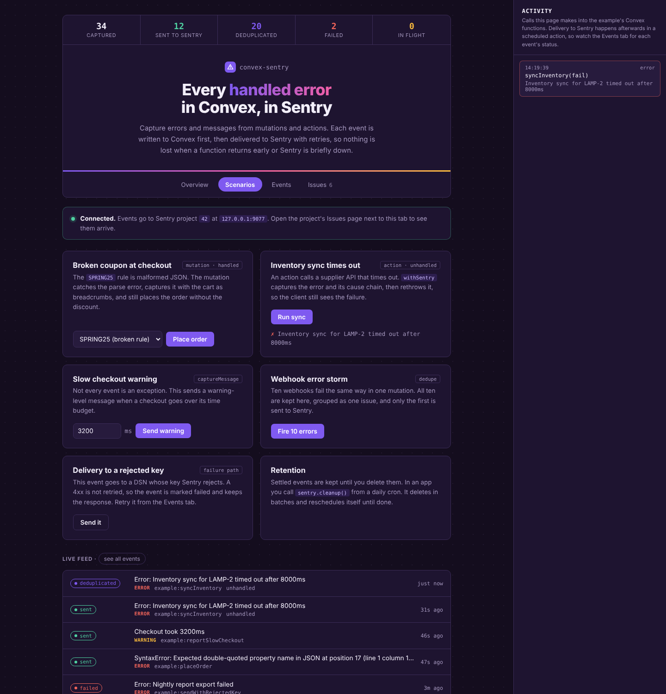

# convex-sentry

**Report handled errors and messages from Convex mutations and actions to
Sentry.** Every event is written to Convex first, then delivered by a scheduled
action with retries, dedupe, and a live local record of what was sent.

[](https://www.npmjs.com/package/convex-sentry)
[](https://www.convex.dev/components/convex-sentry)
[](https://www.npmjs.com/package/convex-sentry)
[](./LICENSE)



```ts
const sentry = new Sentry(components.convexSentry, {
  dsn: process.env.SENTRY_DSN,
});

export const placeOrder = mutation({
  args: { sku: v.string(), couponCode: v.optional(v.string()) },
  handler: async (ctx, args) => {
    let discount = 0;
    try {
      discount = await applyCoupon(ctx, args.couponCode);
    } catch (error) {
      // The checkout carries on. The error still reaches Sentry.
      await sentry.captureException(ctx, error, {
        functionName: "orders:placeOrder",
        extra: { couponCode: args.couponCode },
      });
    }
    return await ctx.db.insert("orders", { sku: args.sku, discount });
  },
});
```

<!-- START: Include on https://convex.dev/components -->

## What this does

Convex can already forward uncaught exceptions to Sentry through its exception
reporting integration. That covers errors that escape a function. It does not
cover the errors your code catches on purpose: the coupon rule that fails to
parse but should not block a checkout, the webhook you skip and log, the
third-party call you fall back from. Those are often the ones you most need to
see, because nothing else will tell you about them.

`convex-sentry` gives you `captureException` and `captureMessage` for those
cases, in both mutations and actions.

```
  your mutation or action
  ┌─────────────────────────────────────┐
  │ try { … } catch (error) {           │
  │   sentry.captureException(ctx, …)   │──┐ insert, same transaction
  │ }                                   │  │
  └─────────────────────────────────────┘  ▼
                                   ┌──────────────────┐
                                   │ events table     │ status: pending
                                   │ (component)      │
                                   └────────┬─────────┘
                                            │ scheduler.runAfter(0)
                                            ▼
                                   ┌──────────────────┐   POST envelope   ┌────────┐
                                   │ deliver action   │ ────────────────▶ │ Sentry │
                                   └────────┬─────────┘ ◀──── 2xx / 4xx / └────────┘
                                            │               5xx / 429
                                            ▼
                     sent · retrying (backoff) · failed · deduplicated · local
```

Mutations cannot call `fetch`, so the component never sends from inside your
function. It writes the event to its own table and schedules a delivery action.
Because the write is part of your mutation's transaction, the event is recorded
only if your mutation commits, and the delivery cannot be cut off by your
function returning early.

- **Works in mutations and actions.** Capture from a mutation's `catch` block,
  or wrap an action body with `withSentry` to capture and rethrow.
- **Retries that respect Sentry.** Network errors, 5xx and 429 responses are
  retried with exponential backoff, using Sentry's `X-Sentry-Rate-Limits` or
  `Retry-After` header when present. Other 4xx responses fail straight away and
  keep the response text.
- **Dedupe without slowing you down.** Events with the same fingerprint inside a
  window (60 seconds by default) are all kept in Convex, but only the first is
  sent. The check runs in the delivery step, so it adds no shared document to
  your own mutations.
- **A live error feed.** Every event keeps its status, attempts and Sentry
  response, and events are grouped by fingerprint into issues. All of it is
  queryable and reactive.
- **Local-only mode.** Leave the DSN unset and events stay in Convex with the
  status `local`. This works on any Convex plan.
- **More than one Sentry project.** Send a single event to a different DSN with
  the `dsn` option.
- **No SDK dependency.** The component builds Sentry envelopes itself and posts
  them with `fetch`, so it runs in the default Convex runtime without
  `"use node"`.

This is a [Convex component](https://convex.dev/components): its `events` and
`groups` tables live in an isolated schema, not your app's schema, and are only
reachable through the functions this component exposes.

## Table of Contents

- [Install](#install)
- [Quick Start](#quick-start)
- [Usage](#usage)
- [Mutations, actions, and rollback](#mutations-actions-and-rollback)
- [Grouping and dedupe](#grouping-and-dedupe)
- [Retention](#retention)
- [API Reference](#api-reference)
- [Options Reference](#options-reference)
- [Database Schema](#database-schema)
- [Testing](#testing)
- [Example App](#example-app)
- [Limitations](#limitations)
- [Troubleshooting](#troubleshooting)
- [Contributing](#contributing)
- [Changelog](#changelog)

## Install

```bash
npm install convex-sentry
```

**Requirements:** Convex v1.34.1 or later, and a Sentry project (sentry.io or
self-hosted) if you want events sent anywhere. Without one, events stay in
Convex.

## Quick Start

### 1. Add the component

In `convex/convex.config.ts`:

```ts
import { defineApp } from "convex/server";
import convexSentry from "convex-sentry/convex.config";

const app = defineApp();
app.use(convexSentry);

export default app;
```

### 2. Set your DSN

Copy the DSN from your Sentry project's **Settings > Client Keys (DSN)** page:

```bash
npx convex env set SENTRY_DSN https://<key>@<org>.ingest.sentry.io/<project>
```

When you create the Sentry project, pick **JavaScript** or **Node.js** as the
platform.

### 3. Create the client

In `convex/sentry.ts`:

```ts
import { components } from "./_generated/api";
import { Sentry } from "convex-sentry";

export const sentry = new Sentry(components.convexSentry, {
  dsn: process.env.SENTRY_DSN,
  environment: process.env.SENTRY_ENVIRONMENT ?? "production",
});
```

Import `sentry` from this file wherever you capture.

## Usage

### Capture a handled error

```ts
try {
  await chargeCard(ctx, args);
} catch (error) {
  await sentry.captureException(ctx, error, {
    functionName: "billing:charge",
    level: "warning",
    tags: { feature: "billing" },
    extra: { invoiceId: args.invoiceId },
    user: { id: userId },
    breadcrumbs: [
      { category: "billing", message: "Retrying with backup card" },
    ],
  });
}
// Returns: the Sentry event id, or null if the event was sampled out or dropped
```

`captureException` reads the error's stack (source-mapped by Convex), follows
its `cause` chain, and adds a `ConvexError`'s `data` to the event's extra data.

### Capture a message

```ts
await sentry.captureMessage(ctx, `Checkout took ${durationMs}ms`, {
  level: "warning",
  extra: { durationMs, budgetMs: 1500 },
});
```

Messages default to the `info` level.

### Capture and rethrow in an action

```ts
export const syncInventory = action({
  args: { sku: v.string() },
  handler: async (ctx, args) =>
    await sentry.withSentry(
      ctx,
      async () => {
        const res = await fetch(`https://supplier.example/stock/${args.sku}`);
        if (!res.ok) throw new Error(`Supplier responded ${res.status}`);
        return await res.json();
      },
      { functionName: "inventory:sync" },
    ),
});
```

If the callback throws, `withSentry` captures the error with `handled: false`
and rethrows it, so the caller still sees the failure.

### Send an event to another project

```ts
await sentry.captureException(ctx, error, {
  dsn: process.env.SENTRY_DSN_BILLING,
});
```

### Read events and issues reactively

```ts
export const recentErrors = query({
  args: {},
  handler: async (ctx) => await sentry.listEvents(ctx, { limit: 20 }),
});

export const failedDeliveries = query({
  args: {},
  handler: async (ctx) => await sentry.listEvents(ctx, { status: "failed" }),
});

export const issues = query({
  args: {},
  handler: async (ctx) => await sentry.listGroups(ctx),
});
```

### Retry a failed delivery

```ts
export const retryEvent = mutation({
  args: { eventId: v.string() },
  handler: async (ctx, args) => await sentry.retry(ctx, args),
});
```

## Mutations, actions, and rollback

A Convex mutation is a transaction. When it throws, every write it made is
rolled back, and the captured event is one of those writes. So:

- **In a mutation**, capture errors you handle and let the mutation finish. If
  you capture and then rethrow, the event is rolled back with everything else.
  Uncaught mutation errors are what Convex's built-in exception reporting is
  for, so keep it on if your plan includes it.
- **In an action**, writes made through `ctx.runMutation` commit straight away.
  Capturing and then rethrowing is safe, and that is what `withSentry` does.

`withSentry` only accepts an action context, so TypeScript stops you from using
it in a mutation.

Queries are read-only, so they cannot capture events.

## Grouping and dedupe

Each event gets a fingerprint. For exceptions it combines the error type, the
message with ids and numbers removed, the innermost function in your own code,
and `functionName`. For messages it uses the normalized text. So
`Invoice 1042 failed` and `Invoice 7 failed` land in the same group. Pass
`fingerprint: ["…"]` to set it yourself. A custom fingerprint is also sent to
Sentry. Otherwise Sentry applies its own grouping.

When an event is delivered, the component checks whether another event with the
same fingerprint was sent inside `dedupeWindowMs`. If so, the new event is
marked `suppressed` and counted on its group, but not sent. If the first
delivery fails for good, the window is released so the next event can go out.
Set `dedupeWindowMs: 0` to send every event.

## Retention

Settled events (`sent`, `suppressed`, `failed`, `local`) are kept until you
delete them. Call `cleanup` from a cron:

```ts
// convex/crons.ts
import { cronJobs } from "convex/server";
import { internal } from "./_generated/api";

const crons = cronJobs();
crons.daily(
  "prune sentry events",
  { hourUTC: 3, minuteUTC: 0 },
  internal.sentry.prune,
);
export default crons;

// convex/sentry.ts
export const prune = internalMutation({
  args: {},
  handler: async (ctx) =>
    await sentry.cleanup(ctx, { olderThanMs: 7 * 24 * 60 * 60 * 1000 }),
});
```

`cleanup` deletes up to `batchSize` events (default 200), then schedules itself
until nothing older than the cutoff is left. Groups not seen since the cutoff
are deleted too. Queued and retrying events are never deleted.

## API Reference

| Method                                             | Context          | Description                                                                 |
| -------------------------------------------------- | ---------------- | --------------------------------------------------------------------------- |
| `captureException(ctx, error, context?)`           | mutation, action | Records an error and queues it for delivery. Returns the event id or `null` |
| `captureMessage(ctx, message, context?)`           | mutation, action | Records a message (default level `info`) and queues it                      |
| `withSentry(ctx, fn, context?)`                    | action           | Runs `fn`. On a throw, captures it as unhandled and rethrows                |
| `listEvents(ctx, { status?, limit? })`             | query            | Events, newest first, optionally filtered by status                         |
| `getEvent(ctx, { eventId })`                       | query            | One event, or `null`                                                        |
| `listGroups(ctx, { limit? })`                      | query            | Issues grouped by fingerprint, most recently seen first                     |
| `listEventsForGroup(ctx, { fingerprint, limit? })` | query            | One group's events, newest first                                            |
| `getStats(ctx)`                                    | query            | Totals for captured, sent, deduplicated, failed, in flight and local events |
| `retry(ctx, { eventId })`                          | mutation, action | Queues a failed event again. Returns `false` if it is not failed            |
| `cleanup(ctx, { olderThanMs, batchSize? })`        | mutation, action | Deletes settled events and stale groups older than the cutoff               |

`limit` defaults to 50 and is capped at 500.

### Capture context

```ts
type CaptureContext = {
  level?: "fatal" | "error" | "warning" | "info" | "debug";
  tags?: Record<string, string>;
  extra?: Record<string, unknown>;
  user?: { id?: string; email?: string; username?: string; segment?: string };
  breadcrumbs?: Array<{
    message?: string;
    category?: string;
    level?: Level;
    type?: string;
    data?: Record<string, unknown>;
    timestamp?: number; // ms since epoch, defaults to now
  }>;
  fingerprint?: string[]; // custom grouping, here and in Sentry
  functionName?: string; // added as the `function` tag
  handled?: boolean; // default true
  dsn?: string; // send this event to another project
};
```

`extra` and breadcrumb `data` are made safe before they are stored: circular
references, `BigInt`, functions, `Date`, `Map` and `Set` are converted, nesting
is cut at 6 levels, and strings at 8 KB. If an event is still over 200 KB,
breadcrumbs go first, then extra data, then stack traces.

## Options Reference

```ts
new Sentry(components.convexSentry, {
  dsn?: string; // unset: events stay in Convex
  environment?: string;
  release?: string;
  serverName?: string; // default "convex"
  tags?: Record<string, string>; // added to every event
  sampleRate?: number; // 0 to 1, default 1
  dedupeWindowMs?: number; // default 60_000, 0 sends every event
  maxAttempts?: number; // default 5
  enabled?: boolean; // false turns capture off
  beforeSend?: (event: SentryEvent) => SentryEvent | null; // edit or drop
});
```

An invalid `dsn` throws when the client is created, so a typo fails on deploy
rather than silently dropping events.

`beforeSend` runs before the event is stored, so anything it removes, such as an
email address, is never written to Convex either.

## Database Schema

```ts
events: {
  eventId, kind, level, title, fingerprint, payload, dsn?,
  status, attempts, maxAttempts, dedupeWindowMs, nextAttemptAt?,
  lastError?, responseStatus?, functionName?, userId?, environment?,
  handled, createdAt, settledAt?,
}

groups: {
  fingerprint, title, kind, level, functionName?,
  count, sentCount, suppressedCount, failedCount,
  firstSeen, lastSeen, lastEventId, reservedBy?, reservedAt?,
}
```

`status` is one of `pending`, `retrying`, `sent`, `failed`, `suppressed` or
`local`. `payload` is the exact Sentry event JSON that is, or would be, sent.

`getStats()` reads every group and up to 1,000 events per open status, which is
fine for a dashboard. Use `listEvents` with a status filter for anything larger.

## Testing

```bash
npm run test
```

The component is tested with
[`convex-test`](https://www.npmjs.com/package/convex-test). The tests cover
delivery, retries, dedupe and retention against a stubbed Sentry endpoint, the
client's event building, and the example app's functions end to end. To register
this component in your own tests, import `convex-sentry/test`:

```ts
import { convexTest } from "convex-test";
import convexSentryTest from "convex-sentry/test";

const t = convexTest(schema, modules);
convexSentryTest.register(t);
```

In tests, `enabled: false` turns capture off without changing call sites.

## Example App

`example/` is a Vite and React app that runs each part of the component against
your deployment:

- **Broken coupon at checkout:** a mutation catches a JSON parse error, captures
  it with breadcrumbs and user context, and still places the order.
- **Inventory sync times out:** an action fails with a cause chain. `withSentry`
  captures it as unhandled and rethrows it.
- **Slow checkout warning:** a `captureMessage` at the `warning` level.
- **Webhook error storm:** ten copies of one error in a single mutation become
  one issue, with one event sent.
- **Delivery to a rejected key:** an event sent to a DSN that Sentry refuses, so
  you can see the failed state and the retry button.
- **Events and Issues tabs:** every event with its live status, attempts, Sentry
  response and full payload, plus issues grouped by fingerprint.

Run it from the repo root:

```bash
npm install --legacy-peer-deps
npx convex env set SENTRY_DSN https://<key>@<org>.ingest.sentry.io/<project>
npm run dev
```

Skip the `env set` step to run the whole demo in local-only mode.

## Limitations

- Queries cannot capture events, because they cannot write.
- A mutation that captures and then throws loses the event in the rollback. See
  [Mutations, actions, and rollback](#mutations-actions-and-rollback).
- The component sends error and message events only. It does not send
  performance traces, session replays or profiles.
- Stack frames are sent as Convex reports them, already source-mapped. Sentry
  does not apply your uploaded source maps to them.
- There is no automatic instrumentation. You call the capture methods where you
  want them.

## Troubleshooting

**Nothing arrives in Sentry.** Open `listEvents` or the example app's Events tab
and check the event's `status` and `lastError`. A `local` status means no DSN
was set where the client was created. A `suppressed` status means the event was
deduplicated.

**Events fail with 401 or 403.** The DSN's key was revoked or belongs to another
project. Copy it again from **Client Keys** and run
`npx convex env set SENTRY_DSN …`. Then call `retry` for the failed events.

**Events keep retrying with 429.** Your Sentry project hit its rate limit or
quota. The component waits for the period Sentry asks for, up to five minutes
per attempt. Lower `sampleRate` or raise `dedupeWindowMs` to send less.

**Too many separate issues for one problem.** Pass a `fingerprint` that names
the problem, for example `["stripe-webhook-signature"]`.

## Contributing

See [CONTRIBUTING.md](./CONTRIBUTING.md).

## Changelog

See [CHANGELOG.md](./CHANGELOG.md).
